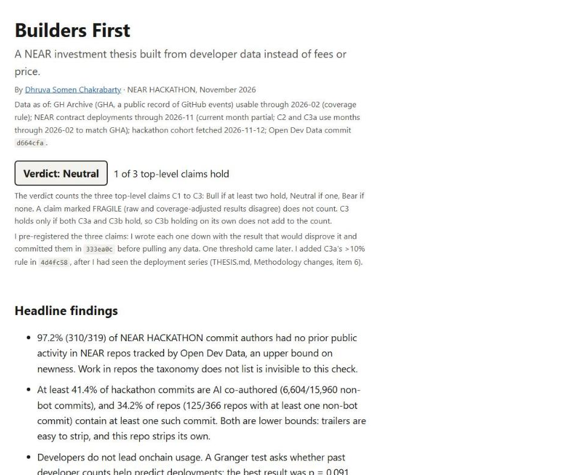

# Builders First

A NEAR investment thesis built from developer data instead of fees or price. By Dhruva Somen Chakrabarty, for the NEAR HACKATHON Investment Thesis track.

<!-- BEGIN GENERATED: exec-summary (do not edit by hand; `make site` rewrites this) -->
**Executive summary for judges**

- **Question:** Are developers coming to NEAR, staying and shipping, and does that lead onchain usage?
- Verdict: Neutral (1 of 3 pre-registered claims hold).
- Investment call: No developer-driven reason to buy NEAR today. Do not add to a NEAR position on developer momentum; base any position on usage evidence such as NEAR Intents revenue.
- Upgrade trigger: Re-rate toward bullish if contracts deployed per monthly active developer rises above 1.66 (now 1.01 raw / 0.84 adjusted), or if a re-run shows developers leading deployments at p < 0.0083.
- Verify in 2 minutes: open the live dashboard (https://dhruva-0206.github.io/builders-first/) or run `make setup && make all` to rebuild every number offline from cached data.

Demo video (1:34): https://x.com/Dhruva_0206/status/2121583776333787179 · Not investment advice.
<!-- END GENERATED: exec-summary -->

<!-- BEGIN GENERATED: one-liner (do not edit by hand; `make site` rewrites this) -->
I tested three pre-registered claims about NEAR's developer base. One holds, barely; two fail. The surprise: almost every hackathon builder is new to the NEAR repos I track (97.2%), and at least a third of their repos show AI co-authorship (34.2%), but developers do not lead onchain usage; the reverse direction is suggestive but not significant.
<!-- END GENERATED: one-liner -->

Live dashboard: https://dhruva-0206.github.io/builders-first/ · [Demo video (1:34)](https://x.com/Dhruva_0206/status/2121583776333787179)

<!-- BEGIN GENERATED: data-why (do not edit by hand; `make site` rewrites this) -->
Data through Feb 2026 (GitHub activity) and Nov 2026 (NEAR deployments). The GitHub series ends in Feb 2026 because the public GH Archive source has a coverage break after that month (shown in the data-quality chart below); the NEAR deployment data runs to Nov 2026.
<!-- END GENERATED: data-why -->

## Verdict and headline findings

<!-- BEGIN GENERATED: verdict (do not edit by hand; `make site` rewrites this) -->
**Verdict: Neutral** (1 of 3 top-level claims hold). The verdict counts the three top-level claims C1 to C3: Bull if at least two hold, Neutral if one, Bear if none. A claim marked FRAGILE (raw and coverage-adjusted results disagree) does not count. C3 holds only if both C3a and C3b hold, so C3b holding on its own does not add to the count.

I pre-registered the three claims: I wrote each one down with the result that would disprove it and committed them in `333ea0c` before pulling any data. One threshold came later. I added C3a's >10% rule in `4d4fc58`, after I had seen the deployment series (THESIS.md, Methodology changes, item 6).

- 97.2% (310/319) of NEAR HACKATHON commit authors had no prior public activity in NEAR repos tracked by Open Dev Data, an upper bound on newness. Work in repos the taxonomy does not list is invisible to this check.
- At least 41.4% of hackathon commits are AI co-authored (6,604/15,960 non-bot commits), and 34.2% of repos (125/366 repos with at least one non-bot commit) contain at least one such commit. Both are lower bounds: trailers are easy to strip, and this repo strips its own.
- Developers do not lead onchain usage. A Granger test asks whether past developer counts help predict deployments; the best result was p = 0.091, against a Bonferroni threshold of 0.0083 (0.05 split across the 6 lags tested). The reverse direction, deployments leading developers, is suggestive (p = 0.012 to 0.026 at lags 2–6) but not significant, so I treat it as exploratory.
- Output per developer fell to 0.56 to 0.67× its 2023–24 level, measured as contracts deployed per monthly active developer (MAD: a GitHub account that pushed code or opened a pull request in an ecosystem repo that month).
<!-- END GENERATED: verdict -->

## Investment implication

<!-- BEGIN GENERATED: implication (do not edit by hand; `make site` rewrites this) -->
Developer data alone does not support a bull case for NEAR today. New developers stay only at par with peers (6-month retention 12.04% vs 12.03%), developers do not lead onchain usage (C2 killed), and output per developer fell to 0.56 to 0.67× its 2023–24 level. A bull case would have to rest on usage-side evidence, such as NEAR Intents volume and fees, which I did not measure here. Developer momentum does not carry it. The one leading indicator worth watching is the AI-assisted newcomer wave: 97.2% of hackathon commit authors (310/319) were new to tracked NEAR repos, and at least 34.2% of repos (125/366) show AI co-authorship. If those builders ship to mainnet and contracts per developer rises above 1.66 (the C3a flip threshold; 1.01 raw and 0.84 adjusted today), the verdict moves toward bullish. This is not investment advice.
<!-- END GENERATED: implication -->

## Try it in 2 minutes

1. `git clone https://github.com/Dhruva-0206/builders-first.git && cd builders-first && make setup && make all`
   → the claims are recomputed from `data/cache/`, `site/index.html` is written, and pytest ends with `N passed`. No credentials or network are needed beyond `pip install`.
2. Open `site/index.html` in a browser, or the hosted copy at https://dhruva-0206.github.io/builders-first/
   → the verdict, the headline findings, the claims scorecard and six charts (developers by ecosystem, retention, developers vs deployments, output per developer, hackathon cohort, GH Archive coverage), each with a CSV download and a table or details view.
3. Optional, needs credentials: `make setup-data && make data` (with `GITHUB_TOKEN`, `GCP_PROJECT` and `GOOGLE_APPLICATION_CREDENTIALS` in `.env`, see `.env.example`), then `make all`
   → rebuilds every cached file from the sources; `git diff data/cache` shows what changed.

CI ([`.github/workflows/rebuild.yml`](.github/workflows/rebuild.yml)) runs `make setup && make all` on a clean Ubuntu runner on every push. It fails if any committed output (claims, site, chart data, or the generated sections of this README and THESIS.md) differs from a fresh rebuild, or if the pre-registered claims in THESIS.md differ from commit `333ea0c`.

On Windows without GNU make, the same steps run as `python -m builders_first.claims`, `python -m builders_first.build_site` and `python -m pytest`, with `PYTHONPATH=src`.

## What I tested

<!-- BEGIN GENERATED: claims (do not edit by hand; `make site` rewrites this) -->
| Claim | Kill criterion | Measured | Status |
|---|---|---|---|
| C1: New NEAR developers retain at least as well as peers (Solana, Sui, Aptos, Base) | NEAR 6-month retention below peer median | 12.04% vs peer median 12.03% | HOLDS (statistical tie) Statistical tie: margin +0.01 pp, NEAR 95% CI 11.34%–12.78% contains the peer median. Fragility: smoothed 6-month 17.86% vs 18.68% (fails); 12-month 7.91% vs 9.03% (fails). |
| C2: NEAR monthly active developers (MAD) lead contract deployments by 1–6 months | No lag with p < 0.0083 (0.05 / 6, Bonferroni) | best p 0.091 raw / 0.124 coverage-adjusted | KILLED Raw and coverage-adjusted MAD agree. |
| C3: AI-era funnel: needs both C3a and C3b | C3a or C3b killed | see C3a, C3b | KILLED |
| &nbsp;&nbsp;↳ C3a: Contracts deployed per MAD rose since 2025 | Post-2025 mean not above 1.10× the 2023–24 mean | 0.67× raw, 0.56× coverage-adjusted | KILLED Mann-Whitney p = 0.705 (raw), not part of the criterion. |
| &nbsp;&nbsp;↳ C3b: A majority of NEAR HACKATHON authors are new to NEAR | New-to-NEAR authors fewer than 50% of the cohort (stricter of two shares) | 97.2% (310/319); 97.4% excluding 11 authors with truncated event feeds | HOLDS AI co-authored: ≥41.4% of commits, 34.2% of repos (125/366 repos with at least one non-bot commit). |
<!-- END GENERATED: claims -->

The conditions that would flip each claim, the exploratory results and the bear case are in [THESIS.md](THESIS.md) and on the dashboard. All of it is generated from [`data/cache/claims.json`](data/cache/claims.json) by [`src/builders_first/report.py`](src/builders_first/report.py), and `tests/test_generated.py` fails if any figure here differs from a fresh computation.

## Data sources and attribution

| Source | Used for | Produced by |
|---|---|---|
| Open Dev Data by Electric Capital (https://github.com/electric-capital/open-dev-data, CC BY 4.0) | Repo lists for NEAR, Solana, Sui, Aptos and Base, sub-ecosystems included | `ingest_ecosystems.py` → `data/cache/repos_*.csv` |
| GH Archive (`githubarchive.month.*`, `githubarchive.day.*` on BigQuery) | Monthly active developers, cohorts, retention, coverage checks | `ingest_bigquery.py` and `sql/` → `data/cache/activity.csv.gz`, `gha_*.csv` |
| NEAR public dataset `bigquery-public-data.crypto_near_mainnet_us.transaction_actions` | Monthly contract deployments and unique deployers | `sql/near_deploys.sql` → `data/cache/near_deploys_monthly.csv` |
| nearhunt.xyz and nearhackathon.com `/api/projects` | Hackathon submissions and repo links | `ingest_hackathon.py` → `data/cache/hackathon_*.csv` |
| GitHub REST API | Hackathon commits since 2026-10-19, authors' public event feeds | `ingest_github.py` → `data/cache/hackathon_commits.csv`, `hackathon_authors.csv` |

Source: Open Dev Data by Electric Capital — https://github.com/electric-capital/open-dev-data

I store GitHub logins only as SHA-256 prefixes (`src/builders_first/ids.py`), and `tests/test_privacy.py` checks that no logins or email addresses appear in `data/cache/` or `site/`. The BigQuery cost of every query is logged in [`sql/COSTS.md`](sql/COSTS.md).

## Method in brief

<!-- BEGIN GENERATED: method (do not edit by hand; `make site` rewrites this) -->
- Pre-registration: I wrote down each claim and the result that would disprove it, and committed them before pulling any data.
- Developer activity comes from GH Archive, a public record of GitHub events. A monthly active developer (MAD) is a GitHub account that pushed code or opened a pull request in one of an ecosystem's repos that month. The repo lists come from Open Dev Data by Electric Capital.
- C1 compares the share of new developers still active 3, 6 and 12 months later, NEAR against the median of Solana, Sui, Aptos and Base, for monthly cohorts from 2022-01.
- C2 uses Granger tests, which ask whether past values of one series improve forecasts of another, on monthly changes in NEAR MAD and contract deployments at lags 1 to 6. With six tests, a Bonferroni correction (dividing the 0.05 significance level by the number of tests) sets the bar at p < 0.0083.
- C3a divides monthly contract deployments by MAD. C3b checks every hackathon commit author for earlier NEAR activity in GH Archive and in their GitHub event feed, and counts commits that carry AI co-author trailers.
- GH Archive's own volume breaks in 2025-06 and collapses after 2026-02. A coded rule stops the series at 2026-02, and I re-ran C2 and C3a on coverage-adjusted MAD.
<!-- END GENERATED: method -->

Full definitions, and every change I made to the method with its date and reason, are in [THESIS.md](THESIS.md).

## Limitations

<!-- BEGIN GENERATED: limitations (do not edit by hand; `make site` rewrites this) -->
- GHA volume breaks in 2025-06 (pushes fall about 30%) and collapses after 2026-02 (pull requests, then pushes). Series end at 2026-02; C2 and C3a are also run on coverage-adjusted MAD, and disagreements would be reported as FRAGILE.
- Developer identity is the GHA actor of a push or PR on a repo listed in Open Dev Data. Electric Capital counts original commit authors, so levels differ from the Developer Report. Private repos and unlisted repos are invisible.
- I started the history at 2021-01 to stay within the BigQuery budget, so some developers counted as new in 2022 had been active before 2021.
- Deployments are transaction-level DEPLOY_CONTRACT only. I excluded factory-created contracts on purpose (THESIS.md, Methodology changes, item 4).
- C3b covers 367 repos with a GitHub link out of 678 nearhunt.xyz projects (764 official submissions); 1,500 commits had no linked GitHub account. 16 authors hit GitHub's 300-event feed cap; 11 of them have feeds that stop after 2026-10-19 and are shown both included and excluded.
- AI co-authorship is detected from commit trailers only, a lower bound. The repo share uses repos with at least one non-bot commit (366 of 367); 1 repo's only author has a login ending in "-bot" and is removed by the bot filter.
- I fixed the C3a threshold (>10%) after I had seen the deployment series. THESIS.md, Methodology changes, item 6, gives the exact order of events with commit hashes.
<!-- END GENERATED: limitations -->

## How I built this

<!-- BEGIN GENERATED: how-built (do not edit by hand; `make site` rewrites this) -->
- I surveyed the 764 public NEAR HACKATHON submissions and picked the angle none of the thesis entries used: developer data instead of fees and price.
- I pre-registered the claims with kill criteria and committed them before pulling any data (`333ea0c`), so the verdict could not be tuned afterwards.
- I set the BigQuery budget and approved each spend. When GH Archive turned out to have coverage breaks, I approved the larger query for one consistent push and pull-request coverage index across the whole period rather than a cheaper mixed method.
- I added the FRAGILE rule: if raw and coverage-adjusted results disagree, the claim is reported as fragile instead of taking the favourable result.
- I kept the results when they came out neutral to bearish, and I cut an overclaim ("developers follow usage") that the statistics did not support.
- I directed AI coding agents (Claude Code) to implement the pipeline, tests and site, reviewed every phase, and approved every change.
- All code in this repository was written during NEAR HACKATHON, November 2026.
<!-- END GENERATED: how-built -->

## Re-run with your own credentials

1. Copy `.env.example` to `.env` and fill in `GITHUB_TOKEN` (a fine-grained token with public-repo read access), `GCP_PROJECT` and `GOOGLE_APPLICATION_CREDENTIALS` (a service-account key with the BigQuery Job User and Data Viewer roles).
2. `make setup-data && make data`. Each BigQuery query is dry-run first and its cost logged to `sql/COSTS.md`; a full rebuild reads several hundred GB, so check your quota first. Chunks already cached in `data/raw/` are never queried again.
3. `make all`, then `git diff data/cache` to see what changed.

## Libraries and tools

pandas, NumPy, SciPy, statsmodels, Plotly (Python, and plotly.js from its CDN on the page), requests, python-dotenv, pytest, google-cloud-bigquery and open-dev-data.

Code written with AI coding assistance (Claude Code) under my direction; methodology, decisions and review are mine.

<!-- also-by:start -->
## Also by this team

[Bet on Beliefs](https://github.com/Dhruva-0206/bet-on-beliefs): a futarchy-governed memecoin treasury on NEAR testnet, also built at NEAR HACKATHON.
<!-- also-by:end -->

## License

MIT, see [LICENSE](LICENSE). Open Dev Data is CC BY 4.0 (attribution above).
